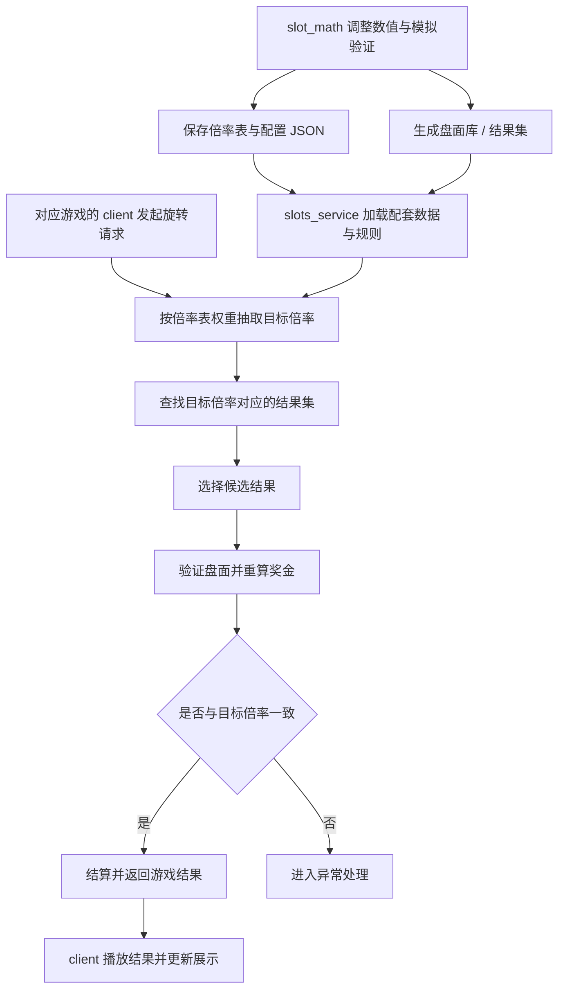

# AISlots

Slots 游戏项目，分为数值工具、服务端和各游戏客户端三部分。

核心思路：在 `slot_math` 中调整数值，将倍率表和配置保存到 `game_configs/<gameId>/`，后续生成盘面库（结果集）；`slots_service` 按倍率表随机抽取目标倍率，查找对应结果集，验证盘面后返回给客户端展示。

本文描述项目的目标架构，尚未实现的能力作为后续开发方向。

## 项目结构

```text
aislots/
├── game_configs/        # 按游戏 ID 管理数值 JSON 文件
│   └── AG1/             # base.json、free.json、config.json、board.json
├── slot_math/           # 数值工具：读写游戏文件、生成盘面库
├── slots_service/       # 服务端：倍率抽取、结果集匹配、盘面验证与结算
└── client/             # 各个游戏的客户端
    └── mahjongway/      # Cocos Creator 3.8.8 麻将游戏客户端
```

## 模块职责

### slot_math：数值工具

- 调整中奖率、倍率权重、免费局及其他玩法参数，分析 RTP、方差并进行模拟验证。
- 读取和保存 `game_configs/<gameId>/base.json`、`free.json`，定义可抽取的倍率及其权重；其他基础、高级参数和模拟选项保存到同目录的 `config.json`。盘面结构、图标库、原始赔率、普通/免费消除加成和金底规则独立保存到 `board.json`，线数读取 `config.json`。
- 生成并输出盘面库，即与倍率对应的游戏结果集。
- 倍率表与盘面库应标明所属游戏、规则版本和数据版本，方便服务端配套加载与校验。

盘面库中的一条结果应包含重放和验证该结果所需的数据。对于消除玩法，结果不只是最终盘面，还应能够描述初始盘面、各轮消除与补充、倍率加成及对应奖金。具体文件格式后续定义。

### slots_service：服务端

1. 加载指定游戏配套的倍率表、盘面库和规则配置。
2. 根据当前游戏状态与倍率表权重，随机抽取目标倍率。
3. 从盘面库中查找该倍率对应的结果集，并选择一条候选结果。
4. 按游戏规则验证候选结果，重算奖金，确认与目标倍率一致。
5. 完成结算并返回经过验证的游戏结果，供客户端播放。

服务端负责权威校验与结算。若没有匹配结果，或盘面验证失败，不应将该候选结果作为成功开奖返回；具体异常处理规则后续定义。

### client：各游戏客户端

- `client/` 下按游戏分别组织客户端，每个游戏拥有自己的场景、资源和表现逻辑。
- 发起配置、下注及旋转等请求。
- 根据服务端返回的结果，播放转轴、消除、补充、免费局和中奖表现。
- 展示服务端确认的奖金、余额及游戏状态。

## 数据与运行流程



## 关键约定

- **先抽倍率，再匹配结果。** 倍率表决定目标倍率的抽取分布，盘面库提供该倍率的具体游戏表现。
- **同一倍率可以对应多条结果。** 结果集内的选择方式及是否使用独立权重，后续定义。
- **盘面必须可验证。** 服务端依据规则重算结果，不能只信任盘面库中记录的奖金。
- **倍率口径必须统一。** 数值工具、服务端和客户端需要明确倍率相对于总投注还是单线投注，以及线数换算、金额精度和取整规则。
- **结果范围必须明确。** 一条结果覆盖单次旋转、完整消除链，还是包含免费局的整段流程，需要在数据协议中定义。
- **游戏数据按版本配套。** 倍率表、盘面库与验证规则需要保持一致，避免混用不同版本。

## 当前进度

- `slot_math`：已有数值分析、权重编辑、随机模拟，以及按游戏目录读取和保存数值与盘面 JSON 文件的功能；无内置默认配置。开发页使用独立 board.json 管理盘面配置，共用数值配置的线数，不执行免费流程；已支持按原始倍率分桶生成紧凑中奖骨架，独立保存到 game_libraries；已实现按骨架补空和免费图标约束。
- `slots_service`：已采用 Go 分层工程，包含开奖核心 `Engine.Spin`、下注业务 `bet.Service.Bet`、平台身份/投注方案、平台接口契约、PostgreSQL 持久化、测试登录与下注凭据、逐轮开奖/派奖和恢复接口；真实平台加减币待接入。调用方式见 [slots_service/README.md](slots_service/README.md)。
- `client/mahjongway`：已复制 Cocos Creator 3.8.8 原项目，保留场景、资源和脚本；原 PixiJS 客户端已移出。已接入 Go 的 login/bets/state/spin，支持逐轮消除、匀速补牌、请求重试及恢复；已迁入原生消除、金底翻百搭、免费、大奖、倍率条和期待动画。

各子项目的运行方式和现有功能详见：

- [slot_math 说明](slot_math/README.md)
- [Cocos 客户端说明](client/mahjongway/README.md)
