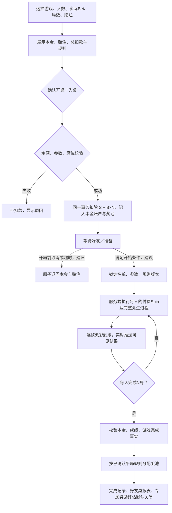
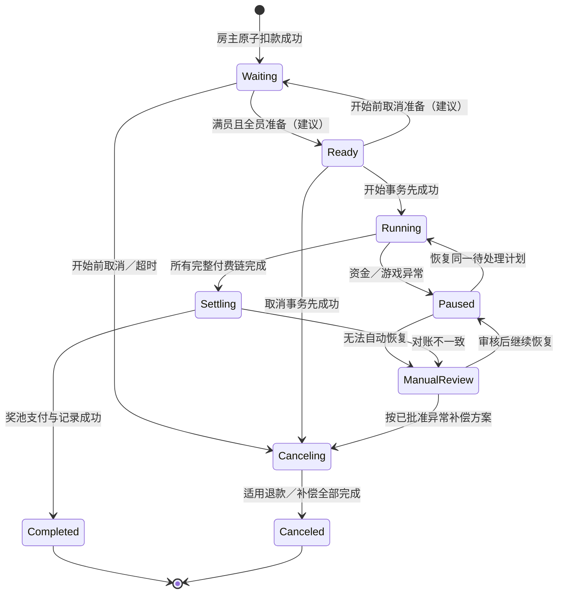
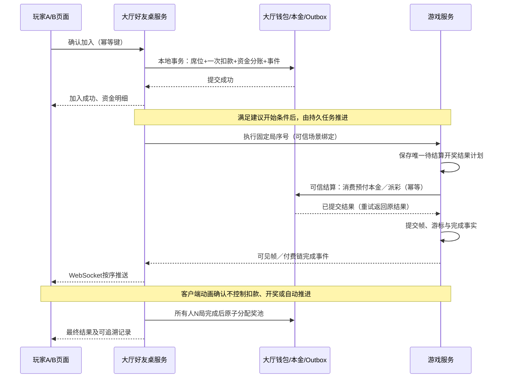
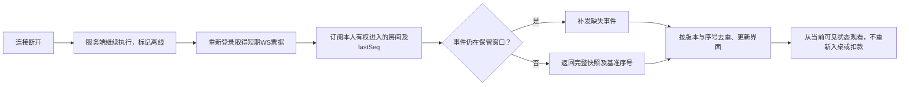
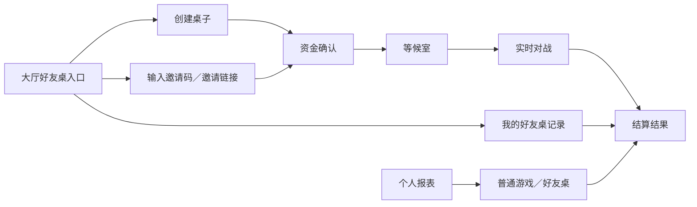

# 好友桌：工作流与交互图

状态：设计草案，未实施。参见 [需求规则](requirements.md) 与 [技术方案](technical-design.md)。图中准备、开始方式和等待超时是建议，资金规则以需求文档为准。

## 业务主流程



开局前扣款必须已经成功才占据正式席位；加入重试不能再次扣款。已开始后，关闭窗口或断线只改变在线状态，不进入取消分支。

## 房间状态



ManualReview 不能自行改判赢家或重新开奖。异常取消须记录已消费本金、已确认派彩、补偿策略版本及审批人；它与开局前全退使用不同原因码。

## 一局执行与资金时序



两服务使用不同数据库；上图不是跨库事务。通过“先存计划、资金幂等确认、同计划提交、事件重投与对账”恢复中间故障，具体见技术方案。

## 掉线与重连



先取得一致快照和基准序号，再接续后续事件；客户端发现缺号主动同步。历史动画可跳过并提示“离线期间已完成 X 局”，不把积压动画强制全部重播。

## 页面路径与布局



### 创建与入桌确认

```text
好友桌 · 创建                           [关闭]
游戏 [已开放游戏]    人数 [2 / 3 / 4]
每局实际投注 [10金币]    付费局数 [20]
每人对战赌注 [100金币]   上限200金币
─────────────────────────────────────
预付游戏本金 200 + 对战赌注 100
本次一次扣除                         300金币
开局后离开，系统仍会完成全部局数。
不计入普通活动；提现流水政策另列说明。
                       [确认并扣除300金币]
```

入桌页展示房主锁定的同一组参数与规则版本，不允许加入者修改。按钮请求中使用旋转 loading、防重复点击与固定尺寸；余额不足不占席、不部分扣款。超时未知时显示“正在核实加入结果”，查询原幂等请求，不能引导用户再付一次。

### 等候室（建议）

展示房间号、邀请入口、目标人数、每人已付金额、准备状态及明确到期时间。显示“尚未开始，可退出并全额退回300金币”。房主开始按钮只在满员、全员准备且无待处理退款时启用；服务端仍重新验证。房主取消与开始并发由房间锁及版本裁决。

### 实时对战

```text
好友桌 #XXXX · 第7/20局               [离开页面]
游戏 / Bet10 / 赌注100 / 总奖池200
┌ 我的盘面（服务端执行） ┐ ┌ 好友盘面（只读） ┐
│ 本局结果、中奖动画      │ │ 当前可见结果      │
└───────────────────────┘ └───────────────────┘
我：7/20  总派彩86          好友：7/20 总派彩92
状态：进行中               在线／系统代玩
                 系统按既定节奏完成所有局数
```

上图展示服务器全程自动的建议；玩家在线是否手动触发 Spin 属于 D07。若保留手动触发，超时或离线由服务器补位，同一局不得执行两次。

3–4人建议使用可切换对手面板，始终显示全部玩家成绩。大屏可并列盘面，小屏突出本人和所选好友。真实盘面嵌入方式需逐游戏适配，不能让只读对手面板获得可操作的普通游戏会话。实时事件只发送已到展示时点的帧，不能把完整未来开奖结果一次下发。

离开确认文案：“离开后系统继续完成剩余13局，押注不会退回。可从我的好友桌返回。”按钮为“继续观看 / 离开页面”。显示掉线、重连、暂停和恢复原因；暂停时不伪造倒计时或继续播放尚未确认的结果。

### 结果与个人报表

结果页展示每人完整局数、总游戏派彩、名次、游戏输赢、押注、奖池所得、专属奖励及净输赢，并提供逐局回放和资金明细。两人同分显示“平局，退回各自押注”；多人部分同分在规则确认前不能开放。

个人报表保留日期筛选并增加“普通游戏 / 好友桌”。好友桌按需求文档口径展示游戏与对战两部分，点击桌号看全桌生命周期；跨日报表标注进行中，避免把当日流水当最终比赛成绩。
