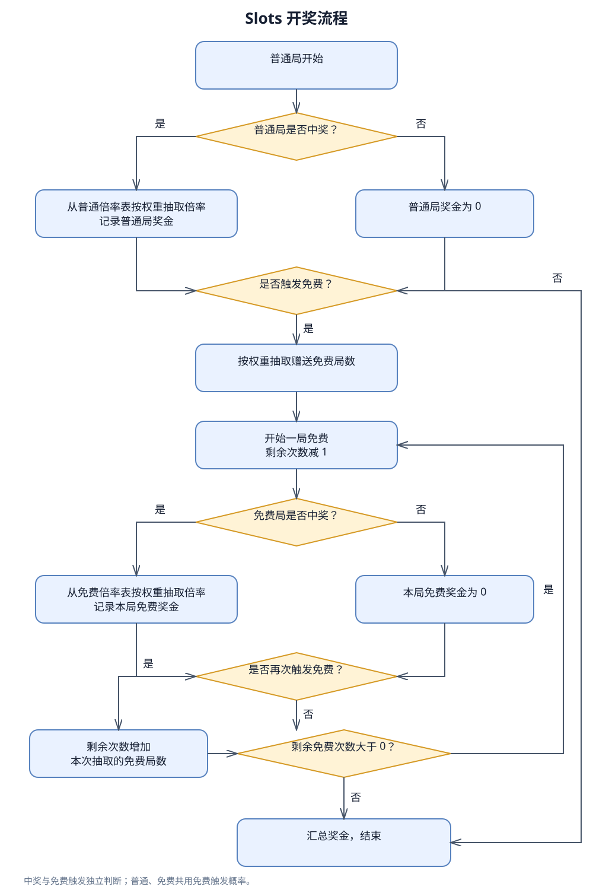
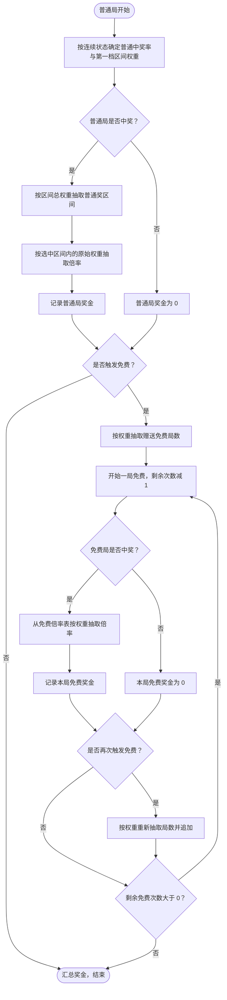

# 开奖流程

## 参数

TypeScript 参数统一使用 `camelCase`，概率使用 `Probability` 后缀；普通局使用 `baseSpin`，免费局使用 `freeSpin`。

| 参数 | 含义 |
| --- | --- |
| `lineCount` | 线数，正整数；奖金 = 表内倍率 ÷ 线数 × 总投注 |
| `baseMultiplierWeights` | 普通中奖后的倍率及其相对权重 |
| `freeMultiplierWeights` | 免费中奖后的倍率及其相对权重 |
| `baseSpinWinProbability` | 普通局中奖概率 |
| `freeSpinWinProbability` | 免费局中奖概率 |
| `freeSpinTriggerProbability` | 普通局和免费局触发免费的概率 |
| `freeSpinAwardWeights` | 免费赠送局数及权重，例如 `[[8,70],[10,20],[12,10]]`，局数为正整数 |

权重表概念上由多条「倍率、权重」记录构成，长度不设业务上限；JSON 格式为 `[[倍率, 权重], ...]`。

## 完整流程图



### Mermaid 源码



## 流程约定

- 中奖判断与免费触发判断使用独立随机抽样，未中奖也能触发免费。
- 普通局和免费局共用 `freeSpinTriggerProbability`，每局最多触发一次免费奖励。
- 免费局每局消耗一次次数；触发追加时独立从 `freeSpinAwardWeights` 抽取局数并增加相应次数，允许重复追加。
- 最后一局免费也要完成追加判断，之后才能决定免费是否结束。
- 倍率只在中奖后按对应权重表抽取；概率判断未中奖时奖金为 0。
- 当前按无免费次数上限建模。

## 金额口径

当前实现以投注 1 为基准，实际派彩 = 表内倍率 ÷ 线数 × 总投注。免费局沿用触发普通局的总投注额与线数。

## 免费次数的数学边界

在无次数上限、各次触发独立的前提下，要使免费总次数的期望有限，需要满足：

`E[N] × freeSpinTriggerProbability < 1`，其中 N 为每次按权重抽取的赠送局数

满足时，一次免费触发带来的期望免费总局数为：

`E[N] / (1 - E[N] × freeSpinTriggerProbability)`

已实现理论计算和参数校验。

## 方差公式

设 q 为免费触发概率，N 为每次按权重抽取的赠送局数，μN = E[N]，vN = Var(N)；μ、v 为计入中奖概率并按线数换算后的免费单局奖金均值与方差。T 为一次触发后的免费总局数，S 为对应免费总奖金。

```text
d = 1 − qμN
E[T] = μN / d
Var(K) = qvN + q(1 − q)μN²
Var(T) = μN × Var(K) / d³ + vN / d²
E[S] = E[T] × μ
Var(S) = E[T] × v + Var(T) × μ²
Free RTP = q × E[S]
Total RTP = Base RTP + Free RTP
总奖金方差 = 普通局奖金方差 + q × Var(S) + q(1 − q) × E[S]²
```

中奖、倍率抽样、免费触发及赠送局数抽取独立，各局独立。K 为一次免费旋转产生的后续免费局数；首次触发的初始局数 N 本身也有方差，因此 Var(T) 含 vN / d²。只配置一档时 vN = 0，退化为原来的固定局数公式。总奖金指一次付费普通局及其引发的全部免费局奖金。

线数参数 `lineCount` 必须为正整数，从当前游戏的 `config.json` 读取。倍率列、平均倍率和最高倍率均显示除以线数后的实际倍率；权重及表内概率不变，单局 RTP 贡献按线数换算。所有奖金均值与标准差除以线数，奖金方差除以线数平方，免费次数指标不变。

## 平均中奖

中奖定义为单次旋转派彩大于 0，不要求超过投注。实际中奖率 = 配置中奖概率 × 表内正倍率概率。普通、免费平均中奖倍率 = 对应单局奖金期望 ÷ 对应实际中奖率，全部以总投注为基准（已除以线数）。

每付费局中奖次数期望 = 普通实际中奖率 + 每付费局免费次数期望 × 免费实际中奖率。综合平均中奖倍率 = Total RTP ÷ 每付费局中奖次数期望，按长期中奖次数加权，含追加免费；它不是一整个付费及免费流程中奖后的条件均值。没有中奖可能时，条件平均值不存在，显示 —，导出为 null。


## 免费触发概率与免费中奖率补偿

付费局按未触发连续次数确定进入免费概率；提升时自动降低免费内部自然中奖率，保持 Free RTP。触发后恢复基础触发率，进入免费时锁定该档免费中奖率，所有追加继续沿用。反求整段 EV 包含随机局数、随机位置保底和追加上限；无法抵消保底最低 EV 时拒绝应用该档。
