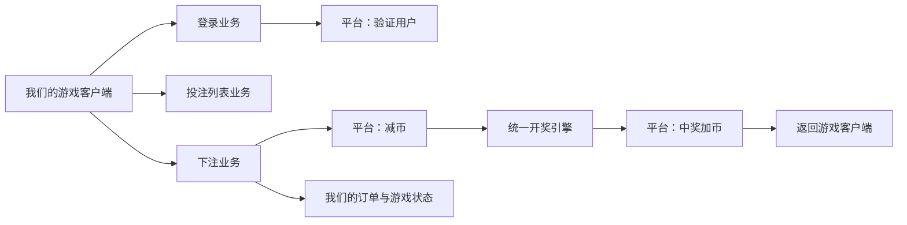
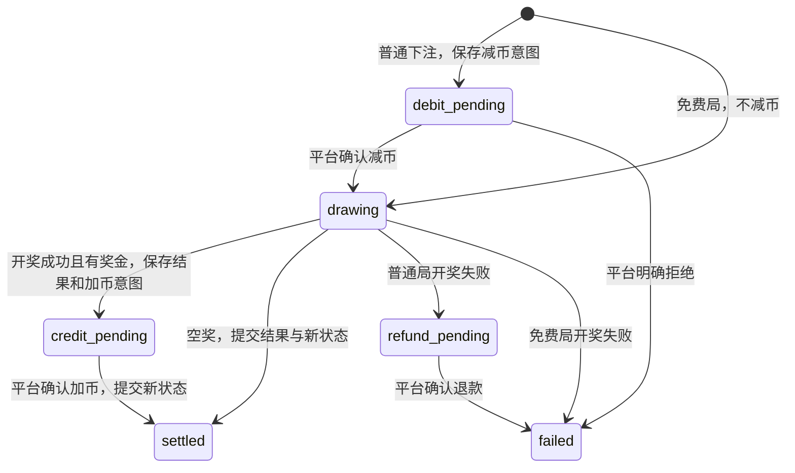

# 第三方游戏服务架构

> 分游戏模块整理与 AG4 接入见 [实施计划](../../docs/superpowers/plans/2026-11-13-go-game-modules-ag4.md)。公共运行契约、AG1～AG3 模块适配和 AG4 普通/锁定重转已落地，已接入本地 Go 测试配置；AG4 Cocos 尚未适配。


**当前客户端联调以 [逐轮接口协议](client-api.md) 为准。** 已落地 PostgreSQL 和固定测试钱包；下文整局平台订单部分是保留的适配用例，尚未接入当前客户端逐轮路由。真实平台仍不维护本地余额。

客户端统一使用 spin，服务端按内部 betId → spinIndex → stepIndex 推进，无需客户端提交索引或动画确认。每次结算与服务端请求标识轮换、幂等回执原子提交；重连state仅返回下一请求标识，不重放上一已结算帧。每次调用只交付当前帧；普通与免费旋转共享同一个 betId。完整结果提前保存，逐轮测试派奖、缓存响应和轮次进度在 PostgreSQL 本地事务内一起提交。最终无奖帧才提交本次旋转状态，免费结束前不能再次付费下注。

测试余额位于独立 test_wallets/test_wallet_ledger 表，仅由显式启用的测试入口使用，不能作为真实平台用户的钱包。

我们提供游戏客户端和游戏服务端。用户账户及余额由接入平台维护；我们保存平台用户对应的游戏状态、下注订单、开奖结果和平台交易凭证，不建立本地用户钱包。

## 调用方向



登录、获取投注列表和下注由我们的客户端调用我们的服务端。验证用户、减币、加币和退款则由我们的服务端调用平台。没有面向平台的下注记录开放接口。

## 身份与隔离

- `appname`：平台唯一标识。
- `appkey`：该平台下应用的唯一标识，不是认证密钥。
- `uid`：平台该应用内的用户唯一标识。

使用结构化 `identity.Subject{AppName, AppKey, UID}`，不拼接可能冲突的字符串。相同 uid 在不同平台、应用下完全隔离。

`login.Service.Verify` 根据 appname/appkey 找到平台适配器，验证平台提供的凭据，核对返回身份，再取得可信国家和币种。未来 HTTP/会话层只将验证后的 `identity.Context` 交给下注服务；客户端不能直接指定可信身份、国家或币种。当前尚未实现会话令牌的签发、存储和 HTTP 登录路由。

记录范围：

| 数据 | 隔离键 |
|---|---|
| 下注请求幂等 | appname、appkey、uid、requestId |
| 游戏状态 | appname、appkey、uid、gameId、country、currency |
| 游戏及普通/免费盘面库 | gameId、Engine 版本及发布批次 |
| 投注列表 | gameId、country、currency，可增加 appname/appkey 覆盖 |
| 平台交易 | 固定交易 ID、完整用户身份、币种、roundId |

同一身份所有游戏共用订单互斥锁；存在尚未完成的订单时阻止该身份的新下注。先保证平台资金操作顺序明确，后续如要放宽跨游戏并发，须专门定义平台钱包并发契约。

## 分层

```text
internal/
  domain/identity/            平台、应用、用户身份及验证后的上下文
  domain/game/                与玩法无关的 Runtime、State、Result 和逐帧派奖计划
  games/registry.go           集中注册游戏模块及历史存档格式
  games/legacyways/           旧 Ways 算法、存档和客户端展示的兼容适配
  games/ag1|ag2|ag3/          各游戏模块入口及展示规则
  games/ag4/                  普通/锁定重转、补盘、实时空奖及最终派奖
  rules/paylines/             纯连线验奖，不包含 AG4 特殊机制
  platform/                   向平台发起验证、减币、加币、查单、退款的接口契约
  application/
    login/                    平台用户验证业务
    betlist/                  按游戏、国家、币种及应用获取/验证投注档位
    bet/                      订单状态机、减币、开奖、加币及恢复
  engine/                     AG1～AG3 共用的 Ways 计算，暂保留原目录
  infrastructure/
    gamedata/                 游戏 JSON、盘面库、投注方案文件读取
    memory/                   开发用订单和游戏状态存储；无用户表及余额
    platform/                 平台适配器注册表；具体协议适配器后续添加
  transport/httpapi/          HTTP 协议转换，目前只开放健康检查
  bootstrap/                  配置和游戏版本装配
```

后续增加游戏，优先新增游戏配置、盘面库、投注方案和客户端表现。共享登录和下注流程。每款游戏注册自己的 `game.Runtime`；AG1～AG3 通过适配器共用 Ways。其他玩法独立提供开奖、状态和帧计划，不给公共请求流程增加游戏 ID 判断。

### 多种玩法的选择

在 `game_configs/<gameId>/config.json` 顶层保存必填字段，由数值工具读取、编辑和保存：

```json
{"ruleType": "ways_cascade_v1"}
```

`ruleType` 标识规则及其算法版本。当前内置 `ways_cascade_v1` 和 `paylines_v1`；`cluster_cascade_v1` 仍为预留名称。规则与游戏模块分别注册，其他连线游戏不会自动继承 AG4 重转。

启动流程为 `ruleType → Factory → 游戏模块注册 → game.Runtime`（`bet.Spinner` 为其兼容名称）。Factory 负责自己的配置校验和数据加载。Runtime 的 `Draw` 返回完整结果、下一状态和明确的逐帧派奖计划，`ValidateStoredResult` 校验已存结果，`Present` 提供模块客户端展示数据。Catalog 存接口而非固定的消除引擎，不需要为每一种玩法修改减币、加币或订单状态机。通用配置解析只检查公共字段，消除专用的金底、免费图标和骨架参数由 Ways Factory 检查。

缺失/未知 ruleType、Factory 返回的类型不匹配均拒绝启动。当前 Ways Engine 的版本标识包含 `ways_cascade_v1` 前缀，订单保存 ruleType；恢复订单时核对该类型，防止改配置后按另一套规则验证/派奖。以后规则算法发生不兼容变化应发布新类型版本，保留仍在使用的旧实现。

服务端先从游戏 config.json 读取规则类型，部署配置只提供文件位置和发布选项，不重复保存 ruleType。工具允许保存未来规则标识，但未实现的规则不能进入 Ways 盘面生成/验证流程，服务端也不会回退。未来新类型接入时，其数据发布格式也应包含规则类型/版本并校验匹配。公共开奖接口已改为 `domain/game` 的版本封套，专属数据为模块校验的 JSON payload，公共层不再依赖 FreeSession、Steps 或 CascadeFactors。AG1～AG3 的旧 HTTP DTO 与历史回放字段仍保留兼容；AG4 连线模块、存档 codec 已注册，专属展示通过可选 gameData 返回。


### 已落地的模块与存档边界

- `domain/game.Runtime`：`Type/Version/Draw/ValidateStoredResult/Present`，公共结果明确列出各帧派奖金额。公共层校验身份、版本、金额非负、溢出及各帧合计；模块校验自己的状态与展示数据。
- `games/legacyways`：旧 Ways 引擎不搬目录、不修改随机顺序；旧按消除轮次的累计取整算法在适配器生成帧计划，最后无奖帧提交旋转状态。模块验奖不读取新骨架、不重新开奖。
- `games/ag1|ag2|ag3`：各有独立入口和展示配置；底部图标、免费第三列金底表现和高列预览的差异在这里选择，不在公共 play 中判断游戏 ID。
- `application/play`：按保存的帧计划派奖，最后一帧提交下一状态。`State.Pending` 只表示付费流程还有后续旋转，不要求是免费局。钱包、帧、游标和请求回执继续使用原事务。
- 新状态/结果保存 `ruleType/version/schemaVersion/payload` 以及公共进度/派奖计划。存储只读兼容旧 Ways state/result 和旧 `StepAmounts`；新旧历史帧都直接使用已保存的展示数据。未知 schema/规则不回退到 Ways。
- 新付费票据选择当前版本，可迁移已结束的 Ways 计数状态；免费流程和已经开奖的帧保持原票据版本。回放 SQL 同时支持旧结果与新封套内的 Ways payload，不暴露未来盘面。
- AG4 使用独立模块及 codec：3×3 五线、Wild 每组合取最高奖、九格同符号 ×10。先选普通或重转，重转替代普通；只扣一次，最终帧一次派奖，不套用 Ways 免费局。
- 正奖按表抽倍率并取对应骨架。普通中奖固定骨架不动，空位仅按剩余合法普通图标的权重逐格补齐，不新增 Wild；加载库时拒绝同线双 Wild 加空位。最终验奖检查中奖明细和倍率完全一致，失败视为不变量错误，不重填、不降奖。重转中奖直接还原骨架，验证目标、锁定、新增及终止。
- 普通空奖按列从左到右、列内从上到下生成，第二列限制同线双 Wild，第三列排除能成线的图标。重转空奖逐格禁止凑齐中奖线，合法位置按 fillProbability 填入；有新增继续，无新增结束，最多六轮新增加一轮无新增。两者实时生成、不读取零桶、不整盘或整条重试。
- 一次补全依赖 AG4 固定的三横两斜五线，以及正权重普通图标数大于单格最多参与的线数（当前六种、最多三条），启动时检查这些条件。权重为零的图标不会成为补空候选。原 baseSpreadWeights 保留在配置中，当前受约束生成不执行生成后的向上复制；MaxFillAttempts 对 AG4 不再生效。运行版本指纹加入 single-pass-v1 标识，存档和派奖结构保持兼容。
- 本地不可变快照为 `testdata/deployments/2026-11-13-ag4-modules/AG4`，包含四份配置、两份库及清单。`cmd/ag4-publish` 独立校验哈希和普通135/135、重转26/26正倍率，拒绝覆盖旧发布。原始配置、候选库和旧零桶均保留。
- 已保存 AG4 结果包含完整帧计划；重启、幂等重试、历史、排行榜与分享沿用已结算展示，不重新补盘。专属数据位于可选 `gameData`。尚未适配 AG4 Cocos，未远程部署。

增加平台时，实现 `platform.Client` 并按 `(appname, appkey)` 注册；认证签名、平台错误码与请求格式在该适配器中转换，不散落到开奖算法中。

## 投注列表

`betlist.Service.List` 使用可信身份上下文和 gameId，精确匹配游戏、国家、币种；先查应用覆盖，再查该游戏国家币种的共享方案，不回退到其他币种、国家或游戏。

配置由 `gamedata.LoadBetPolicies` 读取，示例结构：

```json
[
  {
    "appname": "platform-a",
    "appkey": "app-1",
    "gameId": "AG1",
    "country": "ID",
    "currency": "IDR",
    "amountScale": 0,
    "amounts": [100, 200, 500],
    "default": 100
  }
]
```

这些数字仅展示格式，实际档位须明确配置。省略 appname 和 appkey 代表共享方案。示例文件 `configs/bets.example.json` 是空数组，无内置投注档位，也尚未由服务入口自动装配。普通下注在任何平台资金调用前检查档位；免费沿用锁定投注，不重新套用已变化的普通档位表。

## 下注订单流程

核心方法为 `bet.Service.Bet`，传入可信身份上下文、请求号、游戏和金额。我们不读取、计算或保存本地钱包余额。



1. 按完整身份获取互斥控制，先查原请求。相同参数的已完成请求返回原结果；同请求号不同参数报冲突。
2. 有其他未完成订单时拒绝新下注，先恢复旧订单。
3. 读取游戏状态，校验普通/免费金额及投注档位，锁定 Engine 版本，保存订单。
4. 普通局查询/执行平台减币，确认成功后才开奖。免费局不发减币。
5. 保存完整开奖结果和加币意图，之后才调用平台加币。零奖金不调用加币。
6. 平台确认派奖后，将 settled 订单和新游戏状态在本地原子提交，返回结果。平台余额如果返回，仅作为平台报告的快照，不是我们的资金事实来源。
7. 普通局开奖失败时进入退款流程，引用原减币交易；退款成功后标记失败，游戏状态不推进。免费局失败不扣款、不退款、不推进状态。

平台调用、结果保存或本地提交失败均可能留下处理中订单，不能把“返回 error”当成所有资金动作已回滚。

### 超时、幂等与恢复

- 减币、加币、退款的交易 ID 分别为 `roundId:debit`、`roundId:credit`、`roundId:refund`，重试不变。
- 平台适配器必须保证相同交易 ID 不重复执行，支持按原交易查单；退款引用原减币 ID。
- 每次资金操作先查询原交易。查单确认成功直接继续；明确 `NotFound` 且保证可安全提交时才发原交易。超时、未知、查单不支持不能当成失败重发。
- 平台减币明确拒绝才终止订单；加币或退款拒绝保留处理中状态，等待平台查单确认或人工核对，不擅自改成成功，也不重新开奖。
- 已保存开奖结果后，重试只恢复结算，不重新抽奖。本地尚未保存结果时进程中断，恢复后可能重新执行计算，但不能暴露/支付未保存的结果。
- `Service.Resume(subject, requestId)` 使用已保存请求恢复订单；可供后续对账任务调用。自动扫描未完成订单的后台任务尚未实现。

`Store.WithSubject` 是跨整个流程的锁/租约，**不是包住平台 HTTP 调用的长 SQL 事务**。`SaveOrder` 每一步分别持久提交，失败不能撤销先前已经保存的意图。最终订单与游戏状态必须原子提交。当前内存适配器仅验证行为；正式适配器需要持久化、跨实例锁/防过期持有者写入及唯一约束。

## 我们保存的数据

未来持久化结构围绕这些记录：

| 记录 | 内容 |
|---|---|
| 应用接入配置 | appname/appkey、平台接口地址、密钥引用和适配器类型 |
| 游戏会话 | 经平台验证的身份、国家、币种、有效期 |
| 游戏状态 | 免费局、连续输赢、Engine 版本等 |
| 下注订单 | 请求号、roundId、投注、开奖结果、订单阶段、错误信息 |
| 平台资金操作 | 固定操作 ID、平台交易号、动作、金额、查单和重试记录 |

没有本地用户账户或钱包余额表。平台真实请求/响应的敏感字段需要按最终协议决定保存和脱敏方式。

## 当前范围

已实现业务方法和接口契约、平台适配注册、投注方案选择、内存订单状态机及恢复测试。基础配置仍只有健康检查；测试配置已启用 PostgreSQL 会话、测试登录、投注列表、spin/state。具体真实平台协议和自动对账任务尚未接入。不会将测试平台或测试资金接入正式服务入口。
